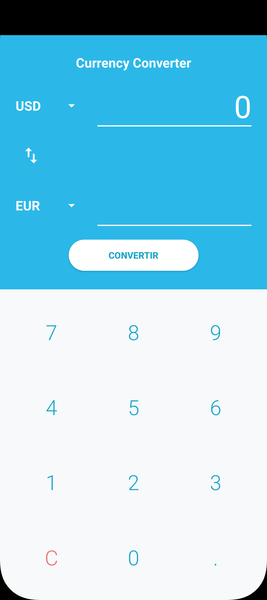
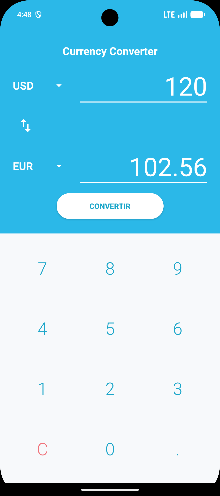
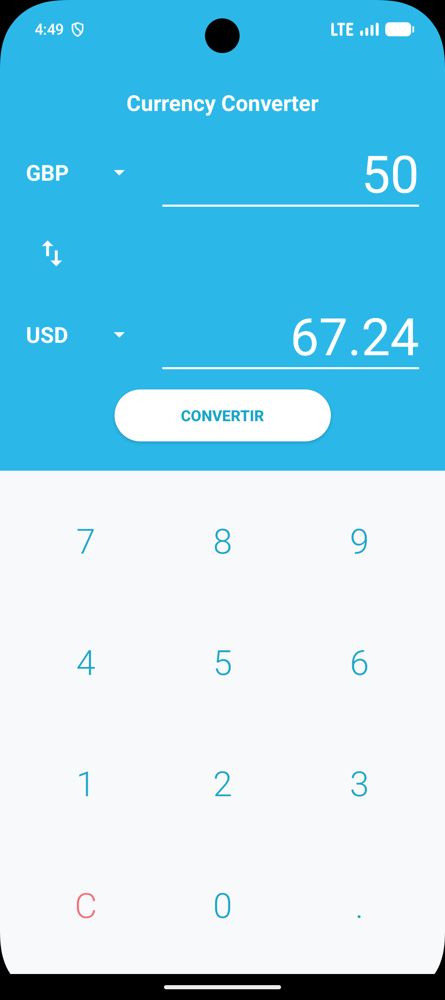

# Currency Converter

TP Android Kotlin — Ayoub Boussoukaya, L3 DSI

Application qui convertit un montant entre 6 devises (USD, EUR, TND, GBP, JPY, CAD) avec des taux fixes et un clavier numérique intégré.

## Fonctionnalités

- Choix des devises avec deux Spinner
- Saisie avec le clavier de l'application
- Conversion en passant par l'euro, résultat avec 2 décimales
- Bouton ⇅ pour inverser les devises
- Un seul point, 10 caractères max, message si le montant est 0
- Bonus : conversion automatique + ViewModel

## Captures

| Démarrage | 120 USD → EUR | 50 GBP → USD | 50 EUR → EUR |
|:-:|:-:|:-:|:-:|
|  |  |  |  |
